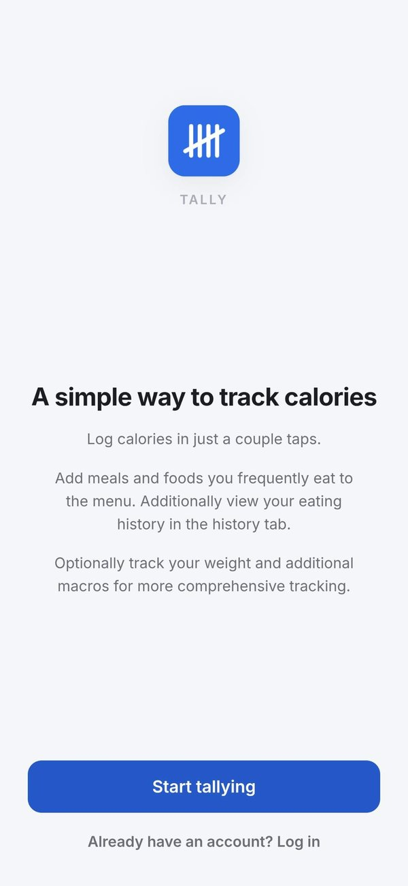
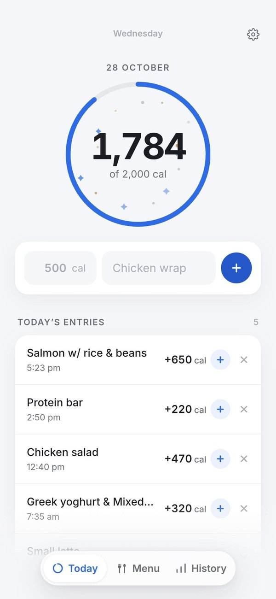
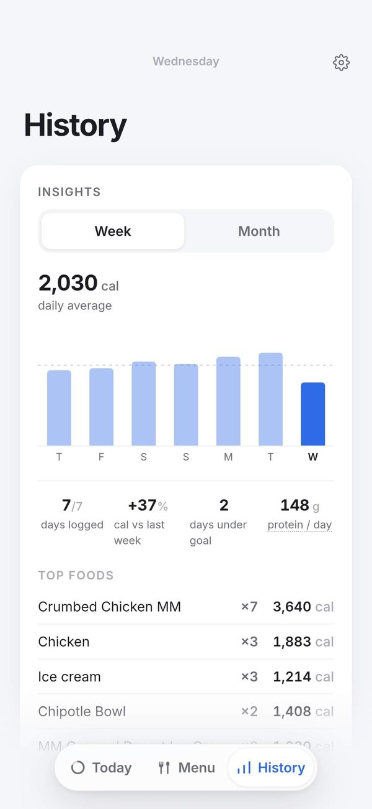

# Tally

A simple calorie and protein tracker. I built it because I wanted a calorie tracker that was fast and well designed, and I use it every day.

<p>
  
  
  
</p>

In beta on TestFlight and Google Play.

## What it does

- Log a meal in a couple of taps: the calories, plus an optional name and macros.
- See today's total in a progress ring against your daily goal. Go over and it turns amber, never red.
- Save the foods you eat often to the Menu and log them in one tap.
- Look back in History: past days, a weekly chart and a short recap.
- Light and dark themes, works offline, and exports everything to a JSON backup.

## How it's built

React and TypeScript with Vite, wrapped as a native app with Capacitor. There's no UI framework; the styling is hand-written CSS.

Data stays on the device. It's kept in local storage and mirrored to Capacitor Preferences, so Android's auto-backup picks it up.

A day starts at 2 AM, not midnight, so a late-night snack counts toward the evening before. That rule lives in `src/lib/day.ts` and is unit tested, including month, year and leap-day rollovers.

## Running it

```sh
npm install
npm run dev      # local dev server
npm test         # unit tests
npm run build    # production build in dist/
```

### Android

Needs the Android SDK.

```sh
npm run build && npx cap sync android
cd android && ./gradlew assembleDebug
```

Release builds are signed with a key that isn't in this repo. For a signed build on your own machine, copy `android/keystore.properties.example` to `android/keystore.properties` and fill it in (it's gitignored). CI reads the same values from repository secrets; see `.github/workflows/android.yml`.
